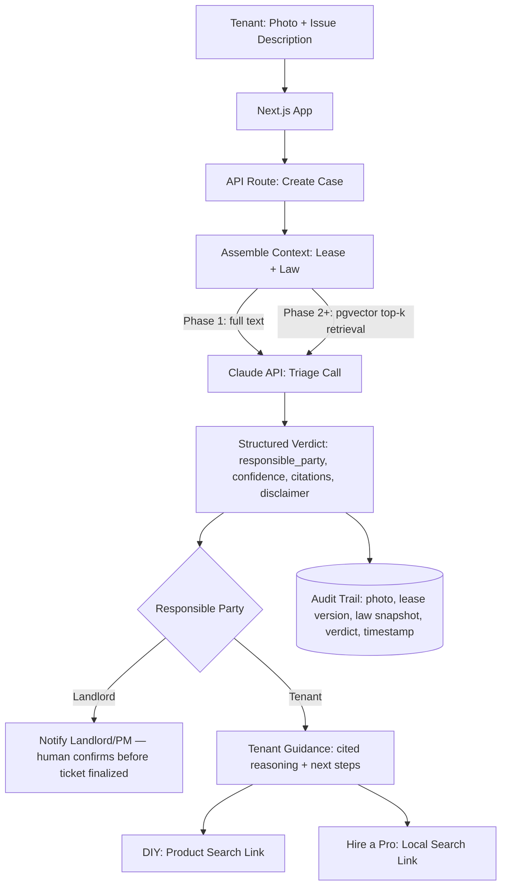

# Architecture Overview: Property Maintenance AI Triage System

A single Next.js application (TypeScript) handles both the UI and the API — no separate backend service. Supabase provides Postgres, file storage, and auth. Claude does the multimodal reasoning: reading the photo, the lease, and the applicable law, and returning a structured, cited verdict.

The design is phased around one constraint: **the legal corpus starts small (Utah only) and grows.** At Utah-only scale, the law fits directly in the model's context window — no retrieval needed. Once a second and third state are added, the corpus becomes too large to paste into every request, and retrieval (RAG) takes over. The schema is built for that transition from day one so it isn't a rewrite later.

## High-Level System Architecture

1. **Application (Next.js / TypeScript), hosted on Vercel:** Serves the tenant-facing upload flow, the landlord/property-manager dashboard, and the API routes that orchestrate everything below. One deployable unit, deployed natively on Vercel (built by the Next.js team — zero-config, image optimization and ISR work without an adapter).
2. **AI Reasoning (Claude API):**
   - **Model:** Claude Opus 4.8 for the triage call (vision + lease + law → structured verdict). Claude Sonnet 5 is a viable cost-optimized substitute for high-volume, lower-stakes routes (e.g., an initial "is this even a valid maintenance photo" pre-check) — swap per-route based on measured cost/accuracy, not by default.
   - **Structured outputs:** The triage call returns a typed JSON verdict (`responsible_party`, `confidence`, `cited_sources[]`, `reasoning_summary`, `disclaimer`) rather than free text — this is what makes the audit trail and the "not a definitive answer" framing enforceable in the UI rather than just a prompt instruction.
3. **Data & Storage (Supabase):**
   - **PostgreSQL:** Users (tenant/landlord/admin roles), properties, leases, cases, and the audit trail (case → photo, lease version, law snapshot, model output, timestamp).
   - **Storage:** Tenant-uploaded photos and lease PDFs/text.
   - **pgvector (provisioned, inactive at launch):** Schema exists now; retrieval activates once the legal corpus spans more than one jurisdiction (see Phasing below).
4. **External Integrations (v1, deliberately minimal):**
   - Product search links (DIY path) — generic search links at launch; affiliate tagging added once a program qualifies.
   - "Find a local pro" — a search link (e.g., Google/Maps query), not a booking integration.
   - No PMS plug-in integration in v1 — see readme.md Non-Goals.
5. **Payments (Stripe):** Landlord/property-manager accounts subscribe via Stripe Billing; tenants are never billed. Stripe Checkout handles signup, the Stripe Customer Portal gives landlords self-serve plan and invoice management, and webhooks (a new `/api/webhooks/stripe` route handler) sync subscription status into the data model. Chosen over Merchant-of-Record processors (Paddle, Lemon Squeezy) because launch is single-state (Utah) — Stripe's simpler self-serve model fits now, with the optional Stripe Tax add-on available later if multi-state sales tax becomes a factor. Provider choice only — billing model (flat vs. per-property vs. per-unit pricing) and which roles are actually billable are open; see launch_decisions.md items 15–16.

## Legal Corpus Phasing

| Phase | Jurisdictions | Retrieval strategy |
|---|---|---|
| **Launch (v1)** | Utah only | Hand-curated law summary + full lease text included directly in the Claude request context, with prompt caching on the shared law summary across requests. No vector search — one jurisdiction is small enough to paste in full and is easier to verify for accuracy than a retrieval pipeline. |
| **Phase 2** | + 2–3 additional states | Introduce `pgvector` retrieval: embed statutes/ordinances per jurisdiction, retrieve top-k relevant clauses at query time based on the tenant's location + issue description, then pass those (not the full corpus) into context alongside the lease. |
| **Phase 3** | County / municipal ordinances layered on top of state law | Retrieval query expands to filter by jurisdiction hierarchy (state → county → city) before the top-k semantic search, since local ordinances can override state defaults for specific issue types. |

This means the case/verdict data model (structured output schema, citation format) is designed once and doesn't change between phases — only how "cited_sources" gets populated (full-context vs. retrieved) changes underneath it.

## Data Flow Diagram

## Hosting

**Vercel, single cloud, no secondary provider (e.g. GCP) required.** The app itself does no heavy compute, storage, or ML — that's all offloaded to Supabase (data/storage) and the Claude API (reasoning), both consumed over HTTPS regardless of where the Next.js app runs. That makes hosting a thin layer, not an architectural decision:

| Option | Verdict |
|---|---|
| **Vercel** (chosen) | Native Next.js host — zero-config deploys, image optimization and ISR work without an adapter. Costs more at scale but removes an entire class of deployment debugging for an MVP. |
| Cloudflare Pages/Workers | Viable, cheaper, better edge network — but requires the OpenNext adapter and has occasional friction with newer Next.js features (some Node.js APIs, image optimization). Worth revisiting once there's traffic to justify the cost/latency tuning. AI calls are I/O-bound, so Workers' CPU-time billing isn't a real constraint if this path is taken later. |
| Secondary cloud (GCP, AWS, etc.) | Not needed. Nothing in this architecture requires compute or storage outside Vercel + Supabase + Anthropic. |

## Key Design Decisions

- **One app, not three services.** The original draft split React / Golang / Python across three deployables. AI latency (seconds per triage call), not request throughput, is the bottleneck here — a separate high-throughput backend language buys nothing at this stage and roughly triples the operational surface (three deploys, three sets of logs, three places a bug can hide).
- **Structured outputs over free text.** Because the "not a definitive answer" framing and the citation trail are legal-risk-relevant, they're enforced as schema fields (`disclaimer`, `cited_sources[]`) rather than hoped for from prompt instructions alone.
- **Human-in-the-loop on landlord-responsible cases.** The AI's landlord-responsible determination creates a pending notification, not an automatic work order — a human confirms before anything binding happens.
- **No marketplace/affiliate APIs at launch.** Thumbtack and TaskRabbit don't expose accessible public booking APIs, and Amazon Associates requires an existing sales history to qualify. v1 links to searches instead of embedding these; both are revisited once there's traffic to justify the integration effort.
- **Stripe over a Merchant-of-Record processor.** Paddle and Lemon Squeezy handle sales tax/VAT collection for you as reseller of record, which matters once selling across many states or countries — not a launch concern for a single-state (Utah) pilot. Stripe's standard model (the business is its own merchant of record) is simpler to integrate now, and Stripe Tax is available later without switching providers if multi-state sales tax becomes real.
