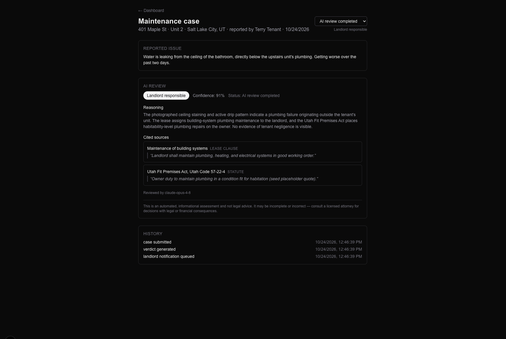
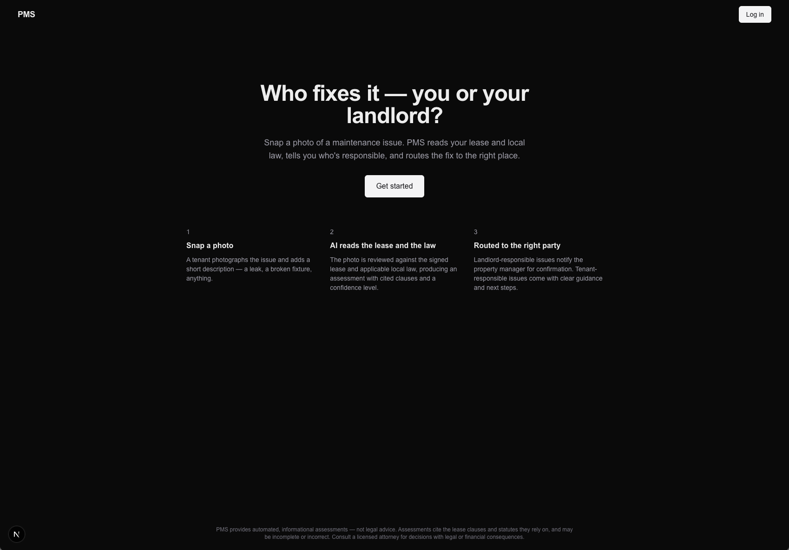
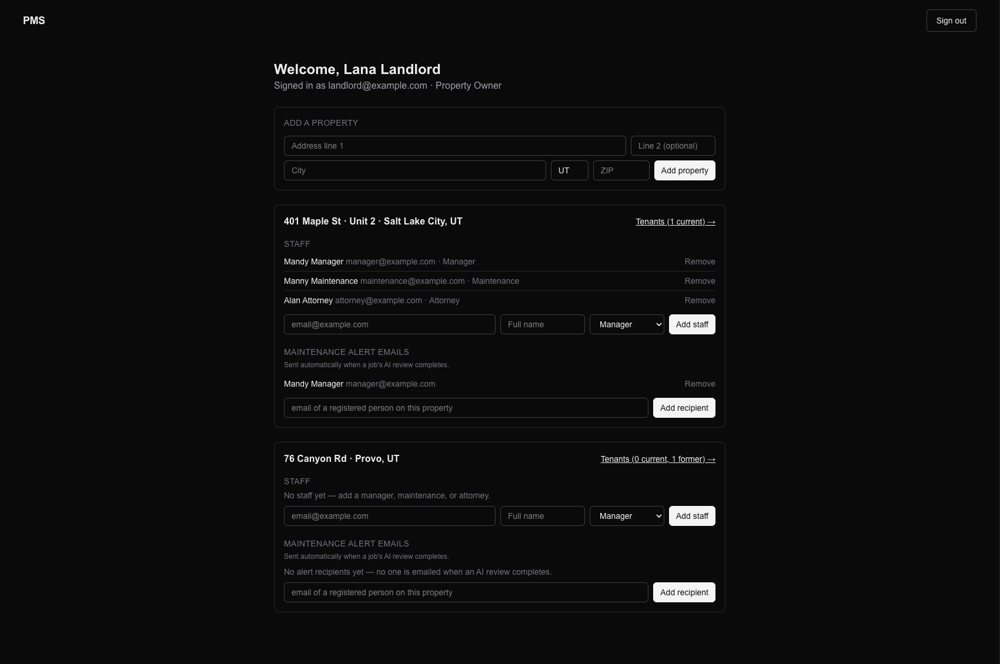
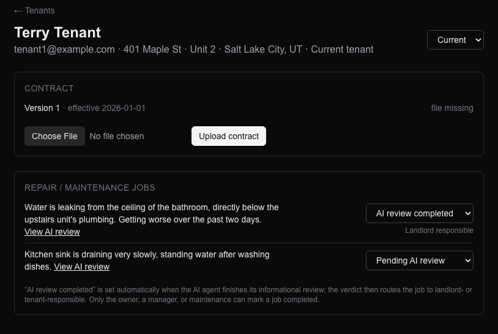

# PMS — AI Property Maintenance Triage

A full-stack web app for property maintenance requests. A tenant photographs a problem and describes it; an AI model reads the photo, the tenant's lease, and the applicable landlord-tenant law, then returns a **cited verdict** on who is likely responsible for the repair — the landlord or the tenant. Property owners and their staff manage properties, tenants, and the resulting jobs, each with role-appropriate access.

> **Portfolio project.** Built as a showcase of full-stack and applied-AI work. It runs locally against a Dockerized Supabase stack and is not deployed or actively maintained. The legal content in the seed data (lease text, Utah law summary) is placeholder text, not legal advice.

Every verdict is framed as informational guidance, not legal advice: it states a confidence score, quotes the exact lease clauses or statutes it relied on, and carries a disclaimer.



## What it does

1. **A tenant reports an issue** — a description plus up to five photos.
2. **The AI review runs automatically** in the background after submission. The model receives the photos, the tenant's lease text, and the jurisdiction's law summary, and must answer in a strict JSON schema: responsible party, confidence, a plain-language reasoning summary, and citations quoted *only* from the provided sources.
3. **The verdict is saved and routed.** The job moves to *AI review completed*, an alert email goes to the people the owner designated for that property, and everyone with access can read the full review — reasoning, citations, confidence, photos, and the case history.
4. **Staff work the job** through a status lifecycle: *Pending AI review → AI review completed → Landlord responsible / Tenant responsible → Completed.*

## Features by role

| Role | What they can do |
|---|---|
| **Tenant** | Report issues with photos; view their own contract (read-only) and their own requests, including the full AI review. Former tenants keep read access but can't file new requests. |
| **Property owner** (landlord) | Sign up self-serve; add properties; add and remove staff; add tenants (current tenants get an invite email, former tenants are added silently); filter tenants by name and current/former status; upload lease contracts; choose who receives AI-review alert emails; manage job statuses. |
| **Manager** | The owner's view for their assigned properties, minus adding properties or managing staff: tenant roster, contracts, jobs, alert recipients. |
| **Maintenance** | A jobs-only view across their assigned properties. Can update job status and mark work completed. No access to contracts or tenant personal information. |
| **Attorney** | Read-only tenant roster and contracts for legal review. Can correct the AI's routing (e.g. move a job from landlord- to tenant-responsible) but can't mark work completed. |
| **Platform admin** | Every account with role management, plus per-request AI token usage. |

Access rules are enforced in the database with Postgres row-level security, not just hidden in the UI — a maintenance worker who types a contract URL directly gets nothing back.

## Screenshots

**Landing page**



**Property owner dashboard** — properties, per-property staff tiers, and who receives AI-review alert emails.



**Tenant detail** — the contract on file and the tenant's maintenance jobs with their status lifecycle.



## Notable implementation details

- **AI triage pipeline** ([`src/lib/triage.ts`](src/lib/triage.ts)) — provider-switchable between Google Gemini and Anthropic Claude via one env var, sharing a single prompt, JSON schema, and validation step. It runs after the HTTP response using Next.js `after()`, so the tenant isn't left waiting on the model. Failures leave the case pending and record an auditable `triage_failed` event; staff can retry from the case page.
- **Citation grounding** — the prompt restricts citations to text that actually appears in the supplied lease and law summary. In testing, quoted clauses matched the source lease verbatim.
- **Token usage tracking** — every model call records input/output tokens per maintenance request in an admin-only table, including calls that were billed but failed, so cost per request can be measured.
- **Row-level security across 9 migrations** ([`supabase/migrations/`](supabase/migrations/)) — per-property collaborator tiers (`manager` / `maintenance` / `attorney`), `security definer` helper functions to avoid recursive-policy errors, and a DB check constraint so alert emails can only go to people actually associated with the property.
- **Auth** — passwordless email one-time codes (15-minute expiry, 3-minute resend throttle) as the primary flow. Self-serve signup is reachable only when sign-in finds no account, gated by a short-lived HMAC-signed httpOnly cookie that is verified on the server. Login and signup forms include a honeypot field for bots.
- **Private file storage** — lease contracts and maintenance photos live in private Supabase Storage buckets and are served through short-lived signed URLs.

## Tech stack

- **Next.js 16** (App Router, React Server Components, Server Actions) with **TypeScript** and **Tailwind CSS v4**
- **Supabase** — Postgres, Auth, Storage, row-level security
- **AI** — Google Gemini (`gemini-3.8-flash`, used in development) and Anthropic Claude (`claude-opus-5-5`, the intended production model), with vision input and structured JSON output
- **Email** — Nodemailer over SMTP (Mailpit captures all mail locally)

## Running it locally

**Prerequisites:** Node.js 20+, Docker, and the [Supabase CLI](https://supabase.com/docs/guides/cli).

```bash
npm install
supabase start        # boots local Postgres, Auth, Storage, and Mailpit in Docker
supabase db reset     # applies all migrations and loads the demo seed data
cp .env.example .env.local
```

Fill `.env.local` with the URL and keys that `supabase start` prints. To enable the AI review, also add a `GEMINI_API_KEY` (free from [Google AI Studio](https://aistudio.google.com/apikey)). Everything else works without one. Then:

```bash
npm run dev
```

Open [http://localhost:3000](http://localhost:3000), go to **Sign in**, and choose **"Sign in with a password instead"**:

| Username | Password | Role |
|---|---|---|
| `admin` | `admin` | Platform admin |
| `landlord@example.com` | `password123` | Property owner |
| `tenant1@example.com` | `password123` | Current tenant with existing cases |
| `manager@example.com` | `password123` | Manager |
| `maintenance@example.com` | `password123` | Maintenance |
| `attorney@example.com` | `password123` | Attorney |

These demo credentials exist only in the local seed file. Emails sent by the app — sign-in codes, invites, AI-review alerts — can be read in Mailpit at [http://localhost:54324](http://localhost:54324).

## Not built

Kept deliberately out of scope for this project:

- **Lease text extraction.** Uploaded contracts are stored and viewable, but their text isn't extracted yet, so the AI review only has text for the seeded leases.
- **Tenant guidance.** The original design had DIY product links and "find a local pro" suggestions for tenant-responsible issues.
- **Billing.** Stripe was chosen as the payment provider, but no billing is integrated.
- **Production deployment** and real Terms of Service (`/terms` is a placeholder).
- **Video** submissions, re-running a review when new photos are added, and multi-state legal coverage.

## Project docs

- [`architecture.md`](architecture.md) — system design, legal-corpus phasing, and hosting rationale.
- [`launch_decisions.md`](launch_decisions.md) — a running log of every design decision and its reasoning: auth method, role model, AI provider, cost tracking, and more.
- [`supabase/README.md`](supabase/README.md) — schema walkthrough, migration-by-migration notes, and the full demo data set.

## Choosing or changing the AI model

The AI review works with either Google Gemini or Anthropic Claude. Set these in `.env.local`, then restart `npm run dev`:

| Setting | What it does | Default |
|---|---|---|
| `AI_PROVIDER` | `gemini` or `claude` | `gemini` |
| `GEMINI_API_KEY` / `ANTHROPIC_API_KEY` | The key for the provider you picked | — |
| `GEMINI_MODEL` | Any Gemini model ID | `gemini-3.8-flash` |
| `ANTHROPIC_MODEL` | Any Claude model ID | `claude-opus-5-5` |

For example, to run reviews on Claude:

```bash
AI_PROVIDER=claude
ANTHROPIC_API_KEY=your-key-here
ANTHROPIC_MODEL=claude-opus-5-5
```

Both providers get the same prompt, response schema, and validation, so switching changes only which model answers. Model IDs are listed in [Google AI Studio](https://aistudio.google.com) and the [Claude model docs](https://platform.claude.com/docs/en/about-claude/models/overview).
